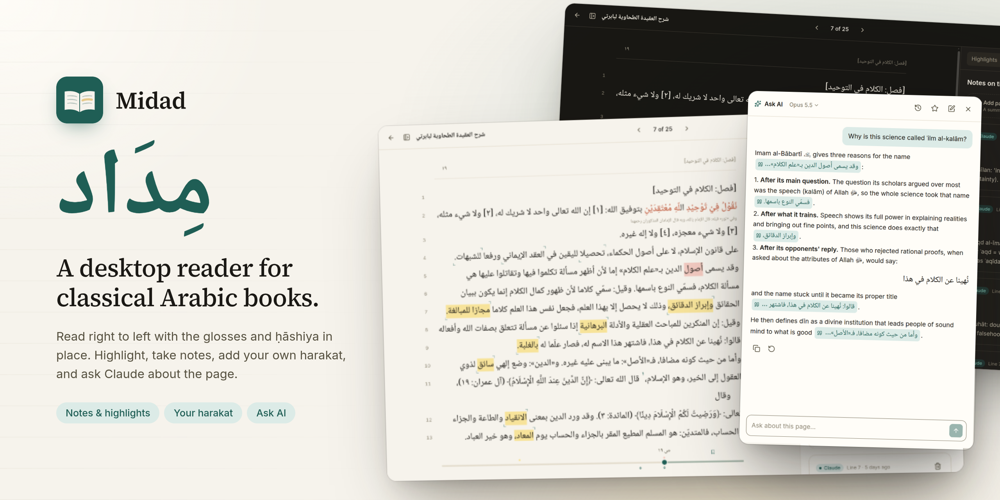
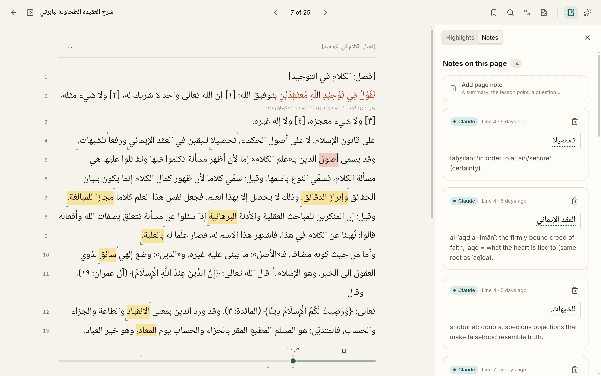
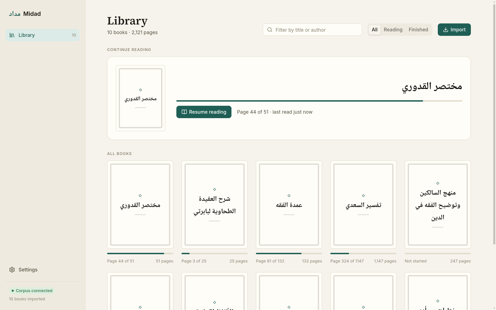
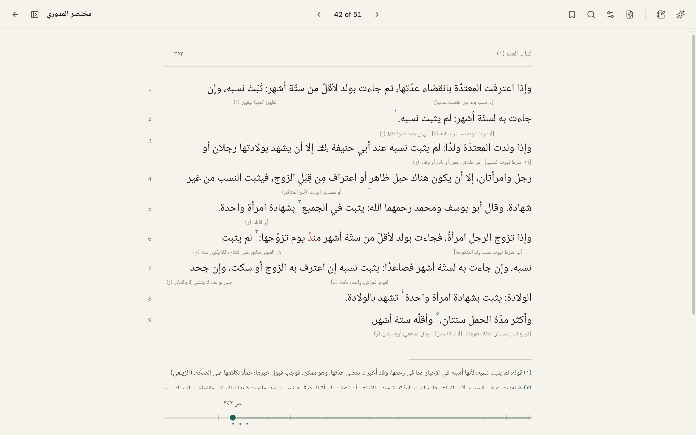
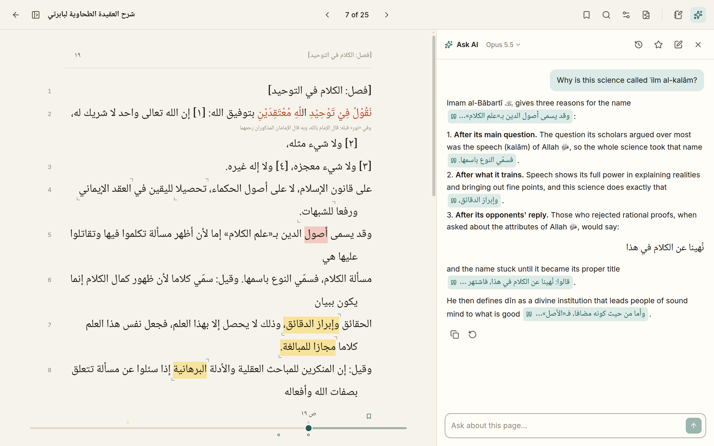
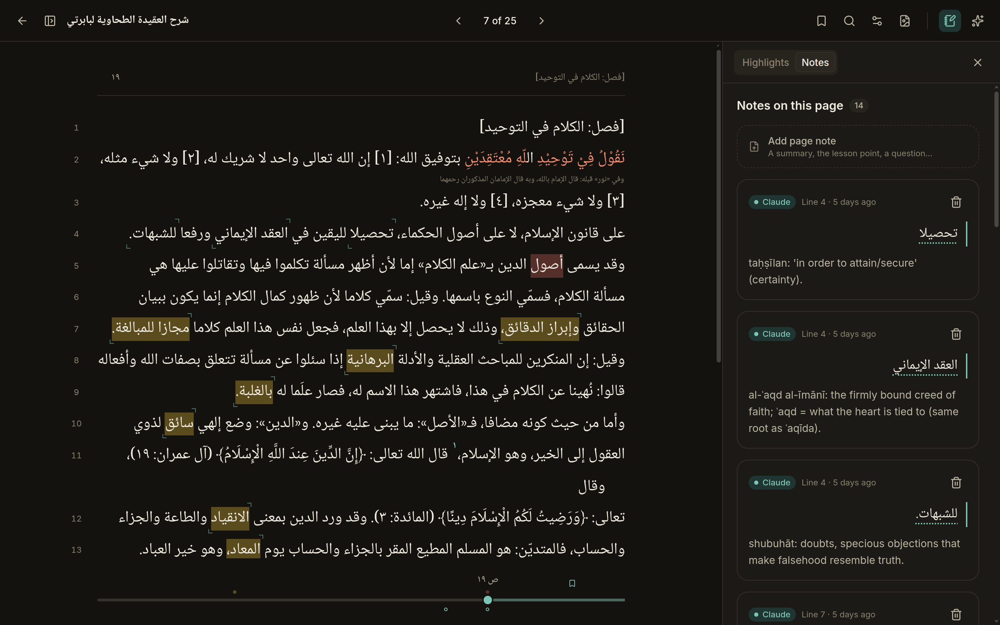

<p align="center"></p>

# Midad (مداد)

A desktop reader for classical Arabic books. You import books from the `arabic-digitization` corpus into Midad's own local library, then read them right to left, with the interlinear glosses and the ḥāshiya where the book puts them. While you read you can:

- highlight passages in four colours,
- write notes on a word or phrase, a whole line, or the whole page,
- add your own harakat to the text, drawn in red so they stand apart from the book's,
- bookmark pages, browse the book's contents, and jump anywhere with the page scrubber,
- open the scan a page was transcribed from,
- read in focus mode, which hides the toolbars while you read,
- ask Claude about the page, with answers that link to the lines they cite.

Midad runs on Windows and Linux, in light and dark.



| | |
|---|---|
|  |  |
|  |  |

## Install

Download the installer for your system from the [Releases page](https://github.com/Shunseii/midad/releases):

- **Windows:** `Midad-<version>-win-x64.exe`. Run it and follow the installer.
- **Linux:** `Midad-<version>-linux-x86_64.AppImage`. Put it in a folder you can write to, such as `~/Applications`, so it can update itself. Make it executable, then run it:

  ```sh
  mkdir -p ~/Applications && mv Midad-*.AppImage ~/Applications/
  chmod +x ~/Applications/Midad-*.AppImage
  ~/Applications/Midad-*.AppImage
  ```

The builds aren't code-signed. On Windows, SmartScreen may say "Windows protected your PC" the first time you run the installer; click **More info**, then **Run anyway**. Your browser may also warn that the file isn't commonly downloaded; choose to keep it.

To import books, open Settings and enter the corpus API URL and key.

**Ask AI** needs [Claude Code](https://docs.claude.com/en/docs/claude-code) on your `PATH`, as the `claude` command, signed in. Midad uses your local Claude Code session, not an API key. You don't need Node.js: the `midad` command Claude reads the page with runs on Midad itself. The rest of Midad works without Claude Code.

### Updates

The Windows app and the Linux AppImage update themselves from the [Releases page](https://github.com/Shunseii/midad/releases). Midad checks when it starts and every 6 hours, downloads a new version in the background, and installs it when you click **Restart** or the next time you quit. A small "Update ready" notice shows when one is waiting; Settings → Updates shows the version, the status and **Check now**. Restart waits while Ask AI is answering.

Self-updating needs the AppImage in a folder you can write to; when it updates, the new file replaces the old one in that folder. A copy that isn't the Windows app or an AppImage (a Linux build run any other way, or Midad run from source) doesn't update itself, and Settings says "Managed outside the app".

Version 0.1.0 has no updater: install the next version by hand once, and it updates itself from then on.

## Set up a new device

These steps take a fresh Windows or Linux computer to a working Midad that syncs with your other devices. Claude Code can run the steps marked **agent**; the steps marked **you** are clicks in the app. You need the sync server address and token, and the corpus API URL and key, which the owner keeps in their password manager. Where the sync server and its secret live: [sync-server/README.md](sync-server/README.md#production).

1. **Agent:** install [Claude Code](https://docs.claude.com/en/docs/claude-code) and sign in (`claude`, then follow its sign-in), so Ask AI works. Node.js isn't needed.
2. **Agent:** download the latest installer from the [Releases page](https://github.com/Shunseii/midad/releases), or with the GitHub CLI:

   ```sh
   # Linux: into a writable folder, so it can update itself
   mkdir -p ~/Applications && cd ~/Applications
   gh release download --repo Shunseii/midad --pattern '*.AppImage'
   chmod +x Midad-*.AppImage
   ```

   ```powershell
   # Windows
   gh release download --repo Shunseii/midad --pattern '*.exe'
   ```

3. **You:** start Midad. On Windows, run the installer; if SmartScreen says "Windows protected your PC", click **More info**, then **Run anyway**. On Linux, run the AppImage.
4. **You:** open Settings → Devices, enter the sync server address and token, and click **Connect**. The agent can put the token on the clipboard for a single paste rather than printing it. Do Devices before the corpus.
5. **You:** in Settings → Corpus, enter the corpus API URL and key, then **Save**.
6. **You:** in the Library, books from your other devices show as waiting. Import them; your highlights, notes and bookmarks land on them as they arrive.
7. **Check:** the Devices indicator at the foot of the sidebar says **Up to date**, and a book's notes match what you see on another device.

## Product decisions

- **Books are imported, then read locally.** Importing pulls every transcribed page of a corpus book, parses it (rules below) and stores the result in Midad's local library, a SQLite database in the app's data folder. From then on the reader, the agent tools and Ask AI read only that local copy; the corpus is not queried while reading. The corpus is the only import source for now.
- **Syncing is explicit.** For an imported book you can pull pages the corpus has gained since import (existing pages are left alone), or overwrite chosen pages with the corpus's current text. Pages the corpus hasn't finished transcribing are skipped and counted as pending.
- **Devices keep your own data in step.** Highlights, notes, harakat, bookmarks, reading places, Ask AI conversations and what Ask AI remembers about you sync between your devices through a small server (`sync-server/`, a Cloudflare Worker). Book text doesn't sync; each device imports its books from the corpus, and books another device has imported show up as waiting. Connect a device in Settings → Devices. Where the server and its token live: [sync-server/README.md](sync-server/README.md#production).
- **Pages:** Library, Reader and Settings. There is no search page and no page that lists every note.
- **Page text is the matn, the ḥāshiya and their glosses.** Corpus pages are markdown: the matn first, then `---` and a `### الحاشية` heading before the footnotes. Interlinear glosses (small text written between the lines) come as `<ruby>base<rt>gloss</rt></ruby>`. Midad keeps the base words in the text and attaches each gloss to the words it explains. The reader prints glosses small under their words, shows them on hover, or hides them (a setting). Highlights, notes and harakat are positioned against the text without the glosses. `midad page` returns the same text, with each line's glosses listed under it.
- **Highlights and notes are separate.** A highlight is a colour on a range of text. A note is text anchored to a word or phrase, shown with a dotted underline. Hovering the anchor opens a popover above or below it, where the note is edited directly and saves itself. A note can also cover a whole line (shown by the line's number) or the whole page.
- **The left panel is about the whole book, the right panel about this page.** The left panel holds the contents and bookmarks, and collapses with a toggle next to the back button; the page re-centres in the freed space. The right panel has the Highlights and Notes tabs, which show only the current page, and Ask AI.
- **Your harakat never change the corpus.** They are stored as a separate layer (position in the page text plus the mark) and drawn over the corpus text in `ink-added` red, so they are easy to tell apart from the corpus's own marks.
- **Adding harakat works like typing.** Click a letter, or select one, to put a caret after it. Type the haraka with the normal Arabic layout (Shift+Q fatha, Shift+E damma, Shift+A kasra, Shift+X sukun, Shift+\` shadda, Shift+W/R/S tanwīn) and it attaches to that letter. Backspace removes your mark, ← → move one letter, Esc leaves. The typed character is used when the OS layout is Arabic. Otherwise Midad maps the physical key (`KeyboardEvent.code`) to its position on the standard Arabic layout, so the same keys work on an English layout.
- **Harakat display:** a "Harakat" switch hides or shows all marks, the corpus's and yours (shortcut `H`). A "My harakat" switch hides only yours. It is disabled while all harakat are hidden.
- **Agent access:** a `midad` command-line tool reads pages from the local library and adds or removes harakat, notes and highlights, so Claude (or any agent with a shell) can work with it. Spans are named by line and word (`--line 4 --words 6-8`), the same anchors the app uses. Notes an agent writes are labelled with the agent's name. The local library has no MCP server; the CLI is the interface.
- **Ask AI cites the page, not the corpus.** Answers link to lines of the matn and ḥāshiya on the current page as inline chips. Clicking one scrolls to that line and highlights it. There are no links to other books.
- **Ask AI uses a local Claude Code session**, not an API key. Midad runs the `claude` command from your `PATH` in its own folder inside the app's data folder, with `midad` on its `PATH`: a small shim (`midad.cmd` on Windows) that runs the bundled CLI on Midad's own executable as Node (`ELECTRON_RUN_AS_NODE`), so no system Node is needed. The corpus MCP server runs the same way. When the corpus is set up, Claude also gets Midad's corpus MCP server (`src/mcp/`), whose tools show a page's stored transcription and its scan, fix transcription mistakes, and list or undo past edits.

## Stack

- **Electron, not Tauri.** Electron ships its own Chromium, so Arabic shaping renders the same on every OS. Tauri uses the system webview (WebKitGTK on Linux), which caused Arabic rendering problems in the past. The harakat layer depends on Chromium's behaviour: a letter wrapped in its own coloured span keeps joining to its neighbours, and its marks take its colour, so a letter you've marked is drawn whole in red.
- The Electron main process (Node) starts the local Claude Code session. The `midad` CLI opens the same SQLite library directly.
- React, Tailwind CSS v4 and Vite (electron-vite), with bundled Noto Naskh Arabic, Inter and Source Serif 4.

## Ask AI behaviour

**Hidden reading context.** Every message to Claude carries a small context block that the user never sees in their own message bubble or in the chat history. It holds only where the reader is:

- the book's ID in the local library,
- the page position (and printed page number),
- the selected text and its line range, when there is a selection.

Claude pulls everything else itself through the CLI (`midad page`, `midad lines`, `midad annotations`), which reads the local library, so the prompt stays small and the text Claude sees is exactly what the reader shows. The reader never sees this block; the selection card at the top of the chat shows what was selected.

**Keeping Arabic and English on separate lines.** The system prompt tells Claude:

- An English paragraph may contain a few Arabic words inline.
- When a paragraph would start with Arabic, the Arabic goes on its own line or lines, and any English follows on a new line. A line never starts in Arabic and then switches to English.

The renderer gives each line or paragraph its own direction (`dir="auto"`, `unicode-bidi: plaintext`). An Arabic line then sets right to left and an English line left to right, whatever direction the panel is in.

## Development

```sh
pnpm install
pnpm dev          # run the app
pnpm test         # vitest
pnpm typecheck
```

### Building and releasing

```sh
pnpm dist         # builds the app and the CLI, then the installers for this OS into dist/
```

`pnpm dist` runs electron-builder (config in `electron-builder.yml`): an NSIS `.exe` on Windows, an `.AppImage` on Linux. Pass `--win` or `--linux` to pick the target.

To release, publish a GitHub release for a `vX.Y.Z` tag on the commit you want to ship:

```sh
gh release create v0.2.0 --target master --title "Midad 0.2.0" --notes "What changed, in a few lines."
```

That triggers `.github/workflows/release.yml`. It takes the version from the tag and writes it into `package.json` for the build only, so there's no version-bump commit; a tag that isn't `vX.Y.Z` fails the run. It builds the Windows and Linux installers on GitHub's runners and attaches them to the release with the update files (`latest.yml` and the `.exe.blockmap` for Windows, `latest-linux.yml` for Linux; the AppImage carries its own block map). Installed copies find the release through those files, so each release needs a version higher than the last. Until both jobs finish, an installed copy that checks may briefly say "Couldn't check: no update published yet". To rebuild the installers for an existing release, run the workflow by hand and give it the tag. The `midad` CLI ships inside the app; there's no separate download.

The update feed is set in `electron-builder.yml` (`publish`, GitHub). `pnpm test:update <folder with a midad.db>` checks a real update end to end on Linux: it builds the AppImage at two versions with a local feed in place of GitHub (in a temp config only), runs the older one from a writable temp folder, and checks that it finds, downloads and, after Restart, runs the newer one. It also checks Ask AI's `midad` command with no `node` on `PATH`. It copies the library folder you give it and never writes to it.

### End-to-end checks

`pnpm test:app` drives the built app the way a person does: it starts Electron headless, then clicks, drags, scrolls and types through the Chrome DevTools Protocol, and checks what happens on screen (the scrubber, focus rings, shortcuts, contents, Ask AI and its queue, library transitions, import, selection, focus mode, page and line notes). It doesn't build anything, so build first:

```sh
pnpm build && pnpm build:cli
pnpm test:app            # every group, about a minute
pnpm test:app ask        # only groups whose name or file matches
```

Each group starts the app on a fresh copy of a synthetic library (a 300-page book with contents, highlights, notes and bookmarks, and a 20-page one) in a temporary `MIDAD_USER_DATA` folder, so your own library is never touched. Ask AI talks to a fake `claude` that streams a long answer, or a shorter one when the question says how long (`[120 words]` takes about two seconds). The checks live in `e2e/checks/`, one file per group; the CDP helpers and fixture are in `e2e/lib/`.

### The `midad` CLI

```sh
pnpm build:cli                                   # writes out/cli/midad.mjs; run by hand, it needs Node 22.13+
ln -s "$PWD/out/cli/midad.mjs" ~/.local/bin/midad

midad books
midad page الآجرومية 3 --words                  # numbered lines, numbered words
midad note add الآجرومية 3 --line 2 --words 4-5 --body "…"
midad harakat set الآجرومية 3 --line 2 --word 3 --letter 4 --marks shadda+fatha
midad --help
```

It opens the library the app uses: `~/.config/midad/midad.db` on Linux, or `%APPDATA%\midad\midad.db` on Windows. To use a different one, set `MIDAD_DB`. Everything it writes is labelled as the agent's. An open Midad window shows the change within a second.

### Designs

- `designs/midad-components.lamsa.json` holds the design system: colour tokens, the type scale, and components with their state grids.
- `designs/midad.lamsa.json` holds the screens, one row per page: Library, Reader, Ask AI, Settings, Dark mode.
- `src/styles/tokens.css` is the token source that lamsa reads, in Tailwind v4 `@theme` form, with light and dark values.

Render with `lamsa render`, and check with `lamsa validate`.
